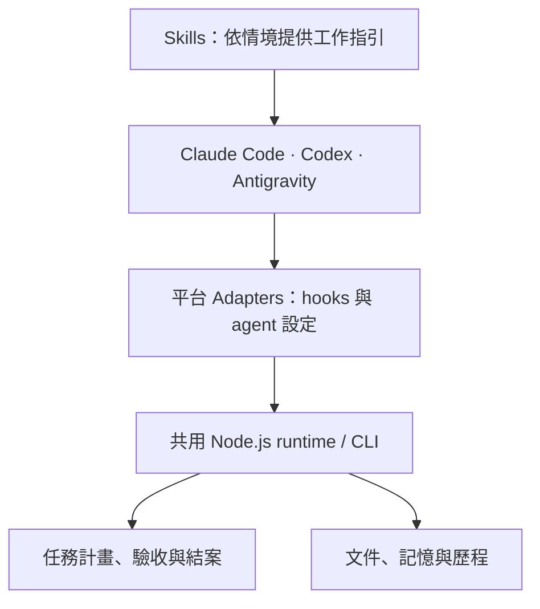

# agent-workflow

Claude Code、Codex 與 Antigravity 共用的 AI 開發工作流框架。整合任務規劃、Skills、驗收、獨立審查與記憶，讓 AI 依任務風險選擇流程，並以實際驗證結果完成交付。

安裝後，照常用自然語言提出需求，agent 會依情境載入指引並執行工作。

## 主要功能

- **任務規劃**：開發前確認目標、範圍與驗收標準，依影響與風險安排流程。
- **驗收與 Review**：實際執行驗收指令，依任務需要進行獨立審查。
- **共用記憶**：保存使用者確認的決策與更正，後續任務可查詢相關脈絡。
- **跨平台支援**：共用規則與 runtime，由 adapter 對接各平台設定。
- **按需載入 Skills**：依情境讀取規劃、除錯、重構等指引。

## 安裝方式

需要 **Node.js 20 以上、npm、Git**，以及要使用的 Claude Code、Codex 或 Antigravity。

```powershell
git clone https://github.com/tian841224/agent-workflow.git
cd agent-workflow
npm install
npm run build
npm run setup
agent-workflow verify
```

安裝時依提示選擇 Skills。若只使用 Codex，將最後兩步改成：

```powershell
npm run setup -- --target-agent Codex
agent-workflow verify --target-agent Codex
```

安裝位置、更新與選用整合見 [安裝與維護](docs/installation.md)。

## Skills

依用途分類；名稱可點開查看完整指引。必裝與選用項目以 [安裝清單](adapters/managed-manifest.json) 為準。

| 分類 | Skill | 用途 |
| --- | --- | --- |
| 規劃 | [workflow](.agents/skills/workflow/SKILL.md) | 任務分流、驗收與結案 |
| 規劃 | [planning](.agents/skills/planning/SKILL.md) | 釐清需求與技術取捨 |
| 規劃 | [implementation-spec](.agents/skills/implementation-spec/SKILL.md) | 撰寫規格與驗收案例 |
| 規劃 | [grill-me](.agents/skills/grill-me/SKILL.md) | 深入提問與檢視高風險假設 |
| 設計 | [codebase-design](.agents/skills/codebase-design/SKILL.md) | 設計模組介面與責任邊界 |
| 設計 | [architecture-review](.agents/skills/architecture-review/SKILL.md) | 檢視架構耦合與遷移風險 |
| 品質 | [tdd](.agents/skills/tdd/SKILL.md) | 以測試驅動開發 |
| 品質 | [root-cause](.agents/skills/root-cause/SKILL.md) | 追查根因並預防再次發生 |
| 品質 | [refactor-sweep](.agents/skills/refactor-sweep/SKILL.md) | 完成重構與引用清理 |
| 品質 | [diagnosing-bugs](.agents/skills/diagnosing-bugs/SKILL.md) | 診斷原因不明的問題 |
| 品質 | [operational-verification](.agents/skills/operational-verification/SKILL.md) | 驗證安裝、部署與外部整合 |
| 文件 | [project-docs](.agents/skills/project-docs/SKILL.md) | 維護專案文件 |
| 文件 | [clean-comments](.agents/skills/clean-comments/SKILL.md) | 說明契約、假設與判斷依據 |
| 文件 | [localization-tw](.agents/skills/localization-tw/SKILL.md) | 使用臺灣慣用繁體中文 |
| 交付 | [git-commit](.agents/skills/git-commit/SKILL.md) | 整理 commit 與 PR |
| 學習 | [learn](.agents/skills/learn/SKILL.md) | 保存經確認的決策與經驗 |
| 學習 | [distill](.agents/skills/distill/SKILL.md) | 提煉可重用的規則草稿 |
| 學習 | [task-retrospective](.agents/skills/task-retrospective/SKILL.md) | 回顧任務的實際執行過程 |

維護本 repo 時另有 [writing-for-agents](.agents/skills/writing-for-agents/SKILL.md)，用於撰寫 agent 與 skill 指引。

## 專案架構



| 目錄 | 職責 |
| --- | --- |
| `.agents/` | 共用規則、Skills 與 agent 指引 |
| `adapters/` | 各平台的設定與安裝對接 |
| `src/` | CLI、任務流程與安裝器 |
| `schemas/`、`templates/` | 資料契約與任務樣板 |
| `docs/` | 使用指南與架構文件 |

詳細設計見 [架構說明](docs/architecture.md)。

## 版本演進

| 版本 | 重點 |
| --- | --- |
| v1 | 建立開發流程與護欄 |
| v2 | 支援跨平台共用 |
| v3 | 從固定流程改為按需組合 |
| v4 | 將流程判定移入 runtime |
| v5 | 明確化任務與驗證契約 |
| v5 → v6 | 精簡角色與技能 |
| v6 | 累積跨平台記憶 |
| v7 | 統一驗證並降低重複成本 |
| v7.1 | 以驗收案例為完成依據 |
| v7.2 | 平行開發交給平台原生 subagent |
| v7.3 | Claude 主對話改為派工與驗證 |
| v7.4 | 主對話改回單一 agent loop |

[使用指南](docs/usage.md) · [架構說明](docs/architecture.md) · [完整版本歷史](docs/history.md)
