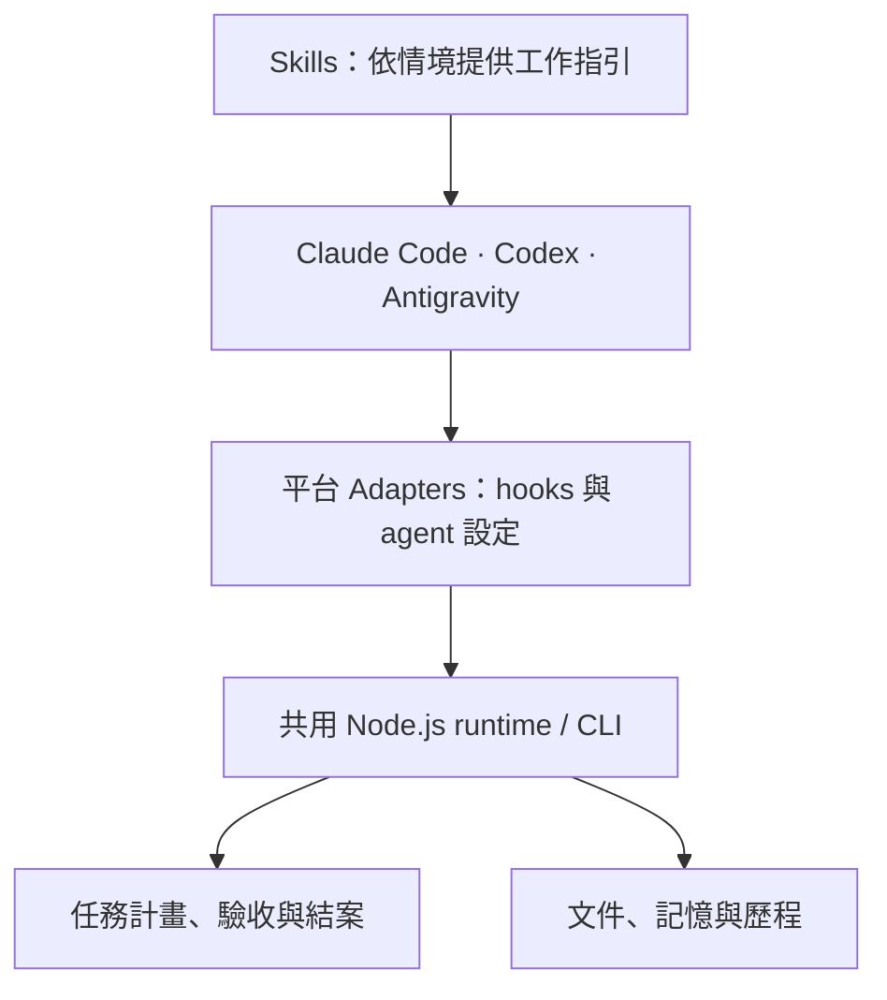

# agent-workflow

Claude Code、Codex 與 Antigravity 共用的 AI 開發工作流框架。整合任務規劃、Skills、驗收、獨立審查與記憶，讓 AI 依任務風險選擇流程，並以實際驗證結果完成交付。

安裝後，照常用自然語言提出需求，agent 會依情境載入指引並執行工作。

## 主要功能

- **任務規劃**：開發前確認目標、範圍與驗收標準，依影響與風險安排流程。
- **驗收與 Review**：實際執行驗收指令，依任務需要進行獨立審查。
- **共用記憶**：保存使用者確認的決策與更正，後續任務可查詢相關脈絡。
- **跨平台支援**：共用規則與 runtime，由 adapter 對接各平台設定。
- **按需載入 Skills**：依情境讀取規劃、除錯、重構等指引。

## 安裝方式

需要 **Node.js 20 以上、npm、Git**，以及要使用的 Claude Code、Codex 或 Antigravity。

```powershell
git clone https://github.com/tian841224/agent-workflow.git
cd agent-workflow
npm install
npm run build
npm run setup
agent-workflow verify
```

安裝時依提示選擇 Skills。若只使用 Codex，將最後兩步改成：

```powershell
npm run setup -- --target-agent Codex
agent-workflow verify --target-agent Codex
```

安裝位置、更新與選用整合見 [安裝與維護](docs/installation.md)。

## Skills

依用途分類；名稱可點開查看完整指引。必裝與選用項目以 [安裝清單](adapters/managed-manifest.json) 為準。

| Skill | 用途 |
| --- | --- |
| [workflow](.agents/skills/workflow/SKILL.md) | 判斷任務是否需要 managed workflow，安排目標、範圍、驗收、執行與結案步驟。 |
| [planning](.agents/skills/planning/SKILL.md) | 在架構方向、技術取捨或需求不明確時釐清問題，形成可執行的方向。 |
| [implementation-spec](.agents/skills/implementation-spec/SKILL.md) | 為 managed 開發任務撰寫待確認規格，說清楚要做什麼、修改範圍與驗收方式。 |
| [grill-me](.agents/skills/grill-me/SKILL.md) | 透過有針對性的提問檢查計畫假設，尤其是高風險或有多種分支的決策。 |
| [codebase-design](.agents/skills/codebase-design/SKILL.md) | 設計模組責任、介面與依賴邊界，避免功能散落或形成重複流程。 |
| [architecture-review](.agents/skills/architecture-review/SKILL.md) | 檢查跨層耦合、模組責任失衡、契約不一致及遷移風險。 |
| [tdd](.agents/skills/tdd/SKILL.md) | 依 red／green／refactor 循環推動行為修改，先用失敗案例明確定義需求。 |
| [root-cause](.agents/skills/root-cause/SKILL.md) | 修正 bug 或確認 review 問題後，追查成因並補上測試、文件或流程防線。 |
| [refactor-sweep](.agents/skills/refactor-sweep/SKILL.md) | 搬移、改名或合併程式碼時，追查引用與測試替身，確認相關文件和行為同步收斂。 |
| [diagnosing-bugs](.agents/skills/diagnosing-bugs/SKILL.md) | 針對成因不明、難以重現、間歇性或效能問題，建立證據並縮小問題範圍。 |
| [operational-verification](.agents/skills/operational-verification/SKILL.md) | 安裝、同步、遷移或部署後，從目標環境讀回狀態並驗證實際入口。 |
| [project-docs](.agents/skills/project-docs/SKILL.md) | 依模組責任與文件類型維護專案文件索引，讓文件反映目前程式與流程。 |
| [clean-comments](.agents/skills/clean-comments/SKILL.md) | 精簡或補充註解，確保契約、假設、邊界及高風險判斷都有準確說明。 |
| [localization-tw](.agents/skills/localization-tw/SKILL.md) | 處理翻譯或臺灣用語疑義，統一使用自然的臺灣繁體中文。 |
| [git-commit](.agents/skills/git-commit/SKILL.md) | 整理提交訊息與 commit 拆分，或撰寫 PR／MR 說明，清楚描述問題、改變與驗證。 |
| [learn](.agents/skills/learn/SKILL.md) | 分類保存使用者明確確認的決策、更正與可重複使用的經驗。 |
| [distill](.agents/skills/distill/SKILL.md) | 從反覆出現的更正或 review 問題提煉規則草稿，供審閱後再採用。 |
| [task-retrospective](.agents/skills/task-retrospective/SKILL.md) | 回顧單次任務實際發生的流程、工具使用、耗時與重試，找出可改善之處。 |

維護本 repo 時另有 [writing-for-agents](.agents/skills/writing-for-agents/SKILL.md)，用於撰寫 agent 與 skill 指引。

## 專案架構



| 目錄 | 職責 |
| --- | --- |
| `.agents/` | 共用規則、Skills 與 agent 指引 |
| `adapters/` | 各平台的設定與安裝對接 |
| `src/` | CLI、任務流程與安裝器 |
| `schemas/`、`templates/` | 資料契約與任務樣板 |
| `docs/` | 使用指南與架構文件 |

詳細設計見 [架構說明](docs/architecture.md)。

## 版本演進

| 階段 | 設計核心 | 主要演進 |
| --- | --- | --- |
| **初版：Claude Dev-Flow Kit** | 用角色指引與開發流程約束 AI 工作 | 建立 Claude 開發流程工具包；README 收錄完整流程。之後明確移除 agent 自行 commit 的做法，保留由使用者掌握 Git 操作的界線。 |
| **v2：規格先行、角色分工** | 以規格和角色責任控制交付 | 重寫流程總控與驗收規約，引入 PM、Architect、QA、Reviewer 等角色；加入 SDD/TDD、hooks 護欄和分層安裝。 |
| **v3：按任務大小調整流程** | 不同規模的任務走不同流程 | 增加微型、標準與重型流程，並設定平行工作的門檻；擴展 Codex、Antigravity 支援，開始把共用規則和平台差異分開。 |
| **v4：Skills 與流程按需載入** | 減少固定流程與常駐指引 | 改為依任務情境載入對應 Skills，簡化入口規則；後續補上條件式品質流程、TDD、獨立 Reviewer、專案文件與平行任務機制。 |
| **v5：runtime 與組合式 Planner** | 把流程選擇與任務狀態從文字規則移向程式管理 | 建立 Python runtime／CLI，加入組合式 Planner、任務狀態、驗收證據和跨平台記憶；開始支援選擇性安裝 Skills，並逐步合併固定角色的職責。 |
| **v6：以 Node.js／TypeScript 統一 runtime** | 讓 runtime 成為工作流程契約的執行者 | runtime 從 Python 移植到 Node.js／TypeScript；建立 task schema、policy、狀態轉換與安裝驗證。 |
| **v7：以 runtime 證據完成驗收，降低流程成本** | 讓完成狀態可驗證，同時依任務風險安排必要流程 | 加入可執行驗收案例、證據與交付內容的關聯、下一步指引及結案 gate，並強化契約與狀態管理。後續將 Review、品質能力和文件讀取改為依情境選用，記憶依任務相關性提供；平行工作使用平台原生 subagent，主對話負責規劃、實作與驗證，只在適合時委派。 |

[使用指南](docs/usage.md) · [架構說明](docs/architecture.md) · [完整版本歷史](docs/history.md)

